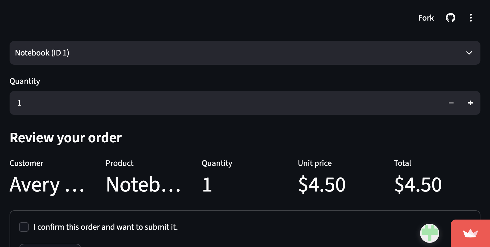
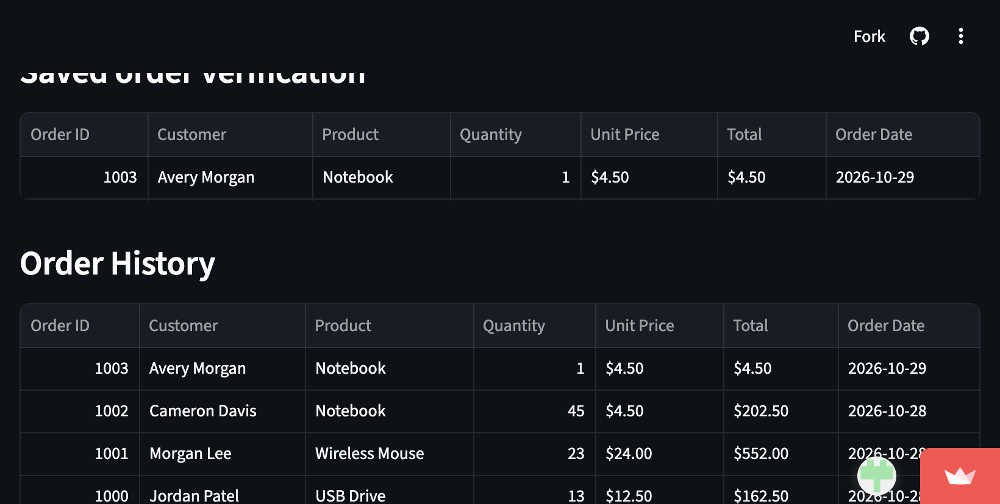

# Campus Store Supabase project

Python starter project for connecting to the Campus Store Supabase database.

## Set up

1. Activate the virtual environment:
   - macOS/Linux: `source .venv/bin/activate`
   - Windows: `.venv\Scripts\activate`
2. Install dependencies: `python -m pip install -r requirements.txt`
3. If `.env` does not exist yet, copy `.env.example` to `.env`.
4. In `.env`, set `SUPABASE_URL`, `SUPABASE_SECRET_KEY`, and `APP_PASSWORD`.
   The URL must be the project URL without `/rest/v1`.
5. In Supabase, make sure the Campus Store SQL setup has been run. It grants
   table access to `service_role` only. The Streamlit app uses the secret key
   on the server and requires the shared classroom app password before making
   database requests.

Keep `.env` private. This key bypasses Row Level Security and grants elevated
database access. Never put it in source code, a public repository, a browser
app, or share it in chat. The `.env` file is excluded from Git.

## Use the client

```python
from database import get_supabase_client

supabase = get_supabase_client()
```

`get_supabase_client()` reads credentials from `.env` (or the process
environment) and raises a clear error if either value is missing. It creates a
client but does not make a database request.

## Run the Streamlit app locally

Create `.streamlit/secrets.toml` from `.streamlit/secrets.toml.example` if you
prefer local Streamlit secrets, or set the same values in `.env`. Never commit
the filled-in secrets file.

```bash
streamlit run app.py
```

The app password gate runs before any Supabase access. It is a classroom
access control, not a production authentication system.

## Publish on Streamlit Community Cloud

1. Push this repository to GitHub. Include `app.py`, `database.py`,
   `requirements.txt`, `.gitignore`, and this README.
2. At <https://share.streamlit.io/>, create an app using this repository,
   branch, and `app.py` as the entry point.
3. In the app's **Settings → Secrets**, add:

   ```toml
   SUPABASE_URL = "https://your-project-id.supabase.co"
   SUPABASE_SECRET_KEY = "your-secret-key"
   APP_PASSWORD = "your-private-classroom-password"
   ```

4. Deploy and test the hosted URL using the checklist below. Give the
   instructor the app password privately.
5. Capture screenshots of the loaded order-entry interface and a successfully
   verified order. Save them under `screenshots/` and ensure they contain no
   credentials before adding them to the repository.

The secret key bypasses Row Level Security and grants elevated database
access. It is used only server-side after the password gate. Never put it in
source code, a public repository, browser code, or a screenshot.

## Assignment: terminal order entry

The separate terminal assignment can be run with:

```bash
python order_entry.py
```

The program retrieves customers and products from Supabase, displays them in
readable tables, validates the selected customer, product, and positive
quantity, inserts one order using the product's current database price, then
retrieves and prints the saved order to verify it. It runs in the VS Code
terminal; it is not a web application.

To print every table for troubleshooting, run `python print_tables.py`.

## Deployment and testing status

Hosted app: <https://class-20261028-ilxlc9ke9rgx3cddbz3lwh.streamlit.app/>

GitHub repository: <https://github.com/mcvii65/class-20261028>

### Deployed application test results

Tests were run against the hosted application on 2026-10-28:

| Test | Result |
|---|---|
| Open app and authenticate | Passed; the hosted page loaded and the app password gate unlocked the interface. |
| Load customers and products | Passed; live Supabase results displayed 20 customers and 12 products. |
| Enter invalid quantity | Passed; entering `0` was rejected with a minimum-quantity error. |
| Submit without confirmation | Passed; the app requested confirmation and inserted no order. The order count stayed at 63. |
| Confirm and submit one valid order | Passed; one order was created: order `1003` for Avery Morgan, Notebook, quantity 1, unit price $4.50. Order count changed from 63 to 64. |
| Retrieve and display verification record | Passed; a new Supabase query retrieved order `1003`, including customer/product names, stored unit price, total, and order date. |
| Refresh after insertion | Passed; order `1003` remained in order history and the order count stayed at 64; refresh did not create a duplicate. |

Screenshots below were captured from the deployed app and contain no
credentials.

#### Order-entry interface



#### Successfully verified saved order


